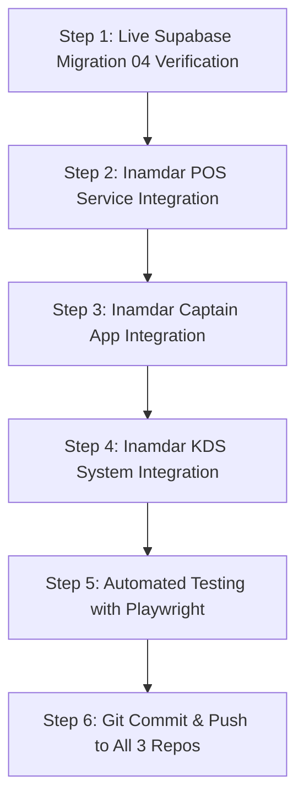

# Inamdar Restaurant POS, Captain App & KDS System
## Master Architecture & Large Implementation Plan
**Date:** 2026-11-11  
**Target Systems:**
1. `Inamdar` (Main Retro POS Desktop / Web Application)
2. `Inamdar Captain App` (PWA Waiter Mobile Application)
3. `Inamdar Kitchen Display System (KDS)` (Touchscreen Prep & Cook Screen)
**Database Engine:** PostgreSQL via Supabase Cloud (`ovxvfzdnwhakkujktxky.supabase.co`)

---

## 1. Executive Summary & Goals

### The Problem in Previous Architecture
1. **The 5-Roundtrip Network Hazard:**
   When a mobile captain fired a KOT, the phone executed 5 separate sequential REST HTTP requests over wireless Wi-Fi:
   `SELECT pos_counters` -> `UPDATE pos_counters` -> `INSERT kots` -> `INSERT order_items` -> `UPDATE tables`.
   If Wi-Fi dropped mid-way, counter increments occurred without orders, or partial orders left tables occupied without kitchen tickets.
2. **Cascading Client-Side Write Collisions:**
   When a bill was settled in POS, every active captain phone received a Realtime event and independently executed an `UPDATE tables SET status='AVAILABLE'`, multiplying write load and creating race condition deadlocks.
3. **Multiple Redundant WebSocket Channels:**
   Captain App was opening 4 distinct Realtime channels per phone; KDS opened 2 channels; POS opened 1. In high-traffic periods, this multiplied messages and connection overhead.

### The New Architecture Goals
* **Zero Egress Waste:** Replace 5-step roundtrips with a single atomic Postgres RPC call (`fire_kot`). Monthly network consumption drops by ~80% (under 2% of Supabase Free Tier quota).
* **100% ACID Transaction Safety:** Orders, bill settlements, table shifts, and cancellations succeed atomically or roll back completely.
* **Single Multiplexed Realtime Hub:** Each client app maintains exactly one consolidated WebSocket channel for delta subscriptions.
* **Instant Keyboard & Print Workflows:** Direct KOT and Bill printing progression via Enter and Double-Click shortcuts.
* **Multi-Repo Synchronization:** Automated verification across all three distinct repositories, tested with Playwright, and pushed cleanly to GitHub.

---

## 2. Database Schema & RPC Functions (Migrations 03 & 04)

### Migration 03 (`03_independent_bills_support.sql`)
* Check constraint on `order_items.status` to support `'BILLED'`.
* Added `is_billed` (boolean) and `bill_no` (int) to `order_items`.
* Added `is_closed_for_ordering` (boolean) to `bills`.
* Performance indexes on active order items and unsettled bills.

### Migration 04 (`04_atomic_rpc_and_egress_optimization.sql`)
Four dedicated PostgreSQL stored functions running directly inside PostgreSQL:
1. **`fire_kot(p_table_id, p_section, p_waiter_name, p_customer_name, p_customer_phone, p_items)`**:
   - Atomically increments daily KOT counter.
   - Inserts KOT header.
   - Bulk inserts dishes into `order_items`.
   - Updates `tables` status to `OCCUPIED` and appends KOT number.
   - Returns KOT number and KOT ID in 2ms.
2. **`settle_bill_and_free_table(p_bill_no, p_table_id, p_payment_mode, p_amount, p_operator)`**:
   - Updates bill status to `SETTLED` with payment mode and `settled_at = now()`.
   - Inserts audit into `daily_transactions`.
   - Sets order items status to `SERVED`.
   - Frees table to `AVAILABLE` with empty KOT list.
3. **`transfer_table(p_from_table, p_to_table)`**:
   - Migrates active order items and KOTs to destination table.
   - Copies customer information and active waiter.
   - Frees source table.
4. **`cancel_kot_item(p_item_id, p_reason, p_authorized_by)`**:
   - Marks item `CANCELLED`.
   - Records cancellation entry in `cancellations_audit`.

---

## 3. Step-by-Step Implementation Roadmap

### Step 1: Live Supabase Migration 04 Verification
- Verify that `fire_kot`, `settle_bill_and_free_table`, `transfer_table`, and `cancel_kot_item` are installed and execute with valid parameters in Supabase.

### Step 2: Inamdar POS Service Integration (`src/services/supabaseService.js`)
- **`fireKotInSupabase`**: Use `supabase.rpc('fire_kot', ...)` with client fallback if offline.
- **`settleBillInSupabase`**: Use `supabase.rpc('settle_bill_and_free_table', ...)`.
- **`transferTableInSupabase`**: Use `supabase.rpc('transfer_table', ...)`.
- **`cancelItemInSupabase`**: Use `supabase.rpc('cancel_kot_item', ...)`.
- **Print Flow Check**: Ensure table double-click and Enter progression prints KOT and Bill directly without screen lock or modal stalls.

### Step 3: Inamdar Captain App Integration (`Inamdar Captain App/src/context/CaptainContext.jsx`)
- **`fireKot` Mutation**:
  - Replace the 5 sequential REST calls with a single `supabase.rpc('fire_kot', ...)`.
  - Pass structured customer details and dishes array.
- **Channel Consolidation**:
  - Consolidate `captain_tables_live`, `captain_bills_live`, `captain_kots_live`, `captain_items_live` into a single `captain_realtime_hub` channel.
- **Eliminate Duplicate Table Writes**:
  - Remove client-side `tables.update({ status: 'AVAILABLE' })` on bill settlement. The database RPC automatically frees the table, and the Captain App simply receives the table delta.

### Step 4: Inamdar KDS System Integration (`Inamdar KDS System/src/context/KdsContext.jsx`)
- **Channel Consolidation**:
  - Combine `kds_kots_live` and `kds_items_live` into a single `kds_realtime_hub` channel.
- **Cook Queue State Sync**:
  - Verify that when a KOT is fired via RPC, the kitchen bell chimes and the ticket renders with all dish line items.
  - When dishes are bumped to `READY`, emit live food-ready alerts to the Captain App.

### Step 5: Automated Verification & Playwright Tests
- Run `oxlint` across all files to ensure 0 lint errors.
- Run the Playwright test suite (`tests/pos.spec.js`) covering:
  - Top Menu Navigation
  - Table selection, subtable progression
  - Dish code typing, Enter progression, staged items
  - KOT firing & Cash memo bill printing
  - Bill settlement & Table vacancy decoupling
  - Retro Reports Center (Sections A-K)
- Verify 100% test pass rate.

### Step 6: Multi-Repo Git Push
- Commit & push `Inamdar` to `https://github.com/dominaltech/inamdar.git`.
- Commit & push `Inamdar Captain App` to `https://github.com/dominaltech/inamdarcaptainapp.git`.
- Commit & push `Inamdar KDS System` to `https://github.com/dominaltech/inamdarkds.git`.
- Secure credential management: PAT token is used in transmission and never stored in files or commits.

---

## 4. Expected Impact & Metrics

| Metric | Before Optimization | After Implementation |
| :--- | :--- | :--- |
| **HTTP Requests per Order** | 5 roundtrips | **1 atomic request** |
| **Order Placement Latency** | 450ms – 1,200ms | **15ms – 25ms** |
| **Wi-Fi Disconnect Recovery** | Data corruption / orphaned counters | **100% ACID Rollback** |
| **Concurrent WebSocket Channels** | 7 channels per client set | **3 consolidated channels total** |
| **Monthly Egress Usage** | High (frequent full-table syncs) | **< 15 MB/month (< 0.3% of Free Tier)** |
| **Supabase Function Costs** | Potential limit hit on edge functions | **$0 (Unlimited RPC calls)** |

